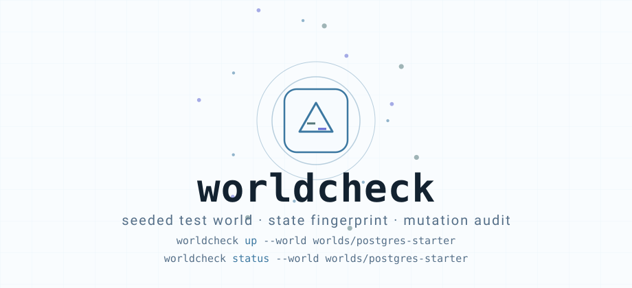
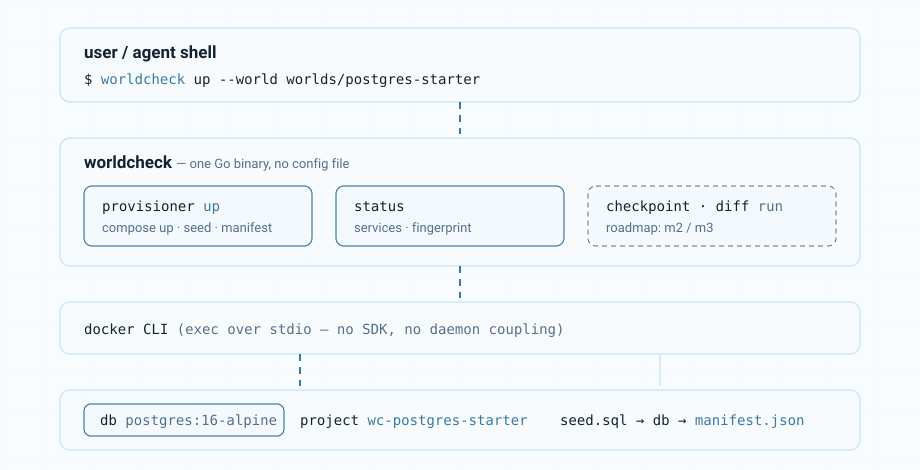
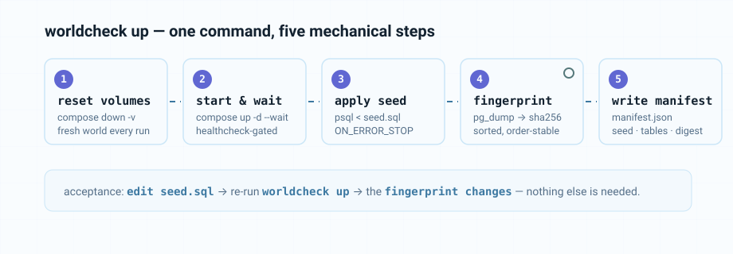
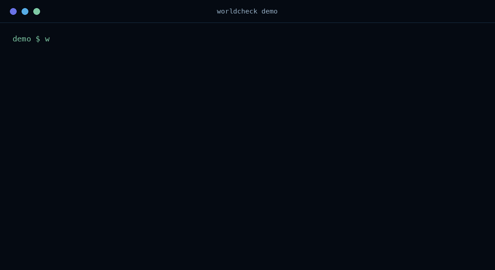
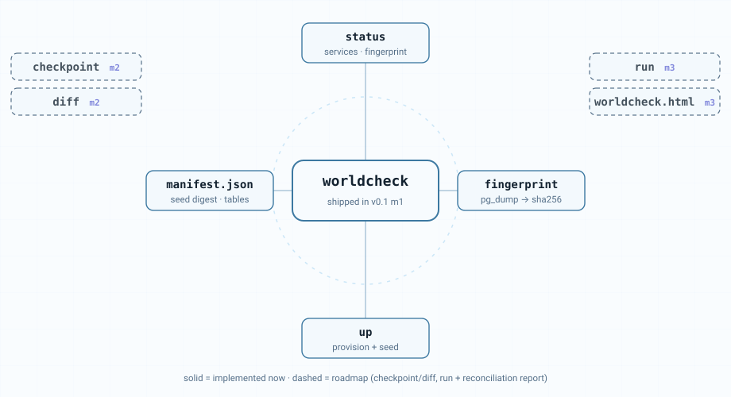

[English](./README.en.md) | **简体中文**

<div align="center">

# worldcheck

<picture>
  <source media="(prefers-color-scheme: dark)" srcset="assets/hero-dark.svg">
  <source media="(prefers-color-scheme: light)" srcset="assets/hero-light.svg">
  
</picture>

[](https://github.com/SuperMarioYL/worldcheck/actions/workflows/ci.yml)
[](https://go.dev)
[](./LICENSE)
[](#安装)
[](#快速开始)


**worldcheck 是编码代理的测试世界检查点工具。** 给每个任务一份可播种的一次性测试世界：一条命令拉起 compose + seed.sql，把种子清单和状态指纹记进 `manifest.json`。改一行种子、重跑一次，指纹必然改变——被审计的世界，从这里开始。

免费开源（MIT），单一 Go 二进制，无配置文件，只依赖本机 Docker。

</div>

## 为什么需要它

把一个涉及数据库的任务交给 Coding Agent：它会自己发明测试数据、自己起环境、自己验证，然后报告「测试通过」。你看到的是绿色，看不到的是它在那个世界里改了什么。

问题不在测试本身，而在**验证环境不可审计**：那个世界是 agent 私自搭的，没有基线，无法重置，也就无法回答「为了凑绿，它到底动了什么」。

worldcheck 从源头接手这件事：世界由工具播种，状态由工具度量。v0.1 的 m1 里程碑交付其中最底层的能力——**可复现的种子世界**。世界一旦可以被精确重建和度量，后续的验证前 checkpoint（m2）与变更对比（m2/m3）才有立足点。指纹是这一切的第一块基石：它让「种子没变」从口头承诺变成一条可以核验的哈希。

## 架构

<p align="center">
<picture>
  <source media="(prefers-color-scheme: dark)" srcset="assets/architecture-dark.svg">
  <source media="(prefers-color-scheme: light)" srcset="assets/architecture-light.svg">
  
</picture>
</p>

一个二进制，一个外部依赖（Docker CLI，通过 stdio 调用，不用 SDK，不与 daemon 版本耦合）：

- **provisioner** —— `up` 读取世界目录里的 `compose.yml` 与 `seed.sql`：`docker compose down -v` 清空旧世界，`up -d --wait` 等 healthcheck 通过，`psql` 灌入种子，`pg_dump --data-only` 抓取结果；
- **manifest** —— 种子 sha256、服务与镜像、每张表的行数、整体状态指纹，全部写进世界目录下的 `manifest.json`；
- **report（终端部分）** —— `status` 把清单渲染成表格。

没有常驻进程，没有自己的数据库，没有 Kubernetes。状态只存在于 Docker（compose 卷）和世界目录的两个文件里：`manifest.json`，以及未来 m3 的 `worldcheck.html`。

## 安装

```bash
go install github.com/SuperMarioYL/worldcheck/cmd/worldcheck@latest
```

或从源码构建（需要 Go 1.24+）：

```bash
git clone https://github.com/SuperMarioYL/worldcheck.git
cd worldcheck && go build ./cmd/worldcheck
```

运行环境要求：本机 Docker daemon 在跑（macOS / Linux；Windows 不在 v0.1 范围内）。无需任何配置文件。

## 快速开始

自带的世界是 `worlds/postgres-starter`：一个 `postgres:16-alpine` 单服务 compose 项目加一份种子 SQL，镜像很小，拉取不会拖垮「一分钟内看到结果」的预算。整条路径只有两步命令：

**1. 播种世界**（真实输出，见 `docs/demo-results.json`）：

```console
$ worldcheck up --world worlds/postgres-starter
world postgres-starter provisioned (project wc-postgres-starter)
  service db (postgres:16-alpine)
  table projects: 3 rows
  table tasks: 6 rows
  table users: 4 rows
manifest written to manifest.json
seeded-state fingerprint: 7d5f34937a7855e218e1ea2ab088e38394f6666d41290651cf50be8a0816dfd4
```

`up` 永远从零开始：先清空这个世界的卷，再播种。世界是一次性的，`up` 从不往旧状态上叠加。

**2. 查看状态与指纹：**

```console
$ worldcheck status --world worlds/postgres-starter
world      postgres-starter
project    wc-postgres-starter
seed       seed.sql (sha256:2a2fb32475ae)
database   app
provisioned 2026-09-16 15:09:52 UTC (worldcheck 0.1.0)

SERVICE  IMAGE
db       postgres:16-alpine

TABLE     ROWS
projects  3
tasks     6
users     4

fingerprint (sha256:pgdump-data-only-sorted-lines)
  7d5f34937a7855e218e1ea2ab088e38394f6666d41290651cf50be8a0816dfd4
```

**验收标准，一条命令验证**：改一行 `seed.sql`，重跑 `up`，指纹必然改变；不改，指纹必然不变：

```console
$ echo 'UPDATE tasks SET done = true WHERE project_id = 2;' >> worlds/postgres-starter/seed.sql
$ worldcheck up --world worlds/postgres-starter | tail -1
seeded-state fingerprint: 9e0f82b6d9f6a412a92956f99844228a186354c1acac9e27a929980bac8bb6a5
```

这就是 m1 的全部：世界可播种、状态可度量、种子与指纹的对应关系可复核。

<p align="center">
<picture>
  <source media="(prefers-color-scheme: dark)" srcset="assets/process-dark.svg">
  <source media="(prefers-color-scheme: light)" srcset="assets/process-light.svg">
  
</picture>
</p>

## 演示

下面是本次 m1 会话的逐帧静态演示：每一帧都是真实命令与真实输出，与 `docs/demo-results.json` 记录的运行一一对应（帧间隔切换，非录屏）。

<p align="center">

</p>

构建这份仓库的机器上 vhs 无法完成编码，所以提交的 GIF 是由真实会话记录渲染的静态帧；仓库同时带有 `docs/demo.tape`（vhs 脚本）与 `docs/demo-record.sh`（一键重录脚本），在 vhs 可用的环境跑一次即可替换为真正的终端录屏。这也不是最终形态——计划中的完整演示（agent 悄悄改自己的种子世界凑绿、被变更对比当场抓住）依赖 m3 的 run/reconcile 能力，将在该里程碑落地后重新录制替换。

## 能力与边界

<p align="center">
<picture>
  <source media="(prefers-color-scheme: dark)" srcset="assets/capabilities-dark.svg">
  <source media="(prefers-color-scheme: light)" srcset="assets/capabilities-light.svg">
  
</picture>
</p>

| 能力 | 状态 | 说明 |
| --- | --- | --- |
| `worldcheck up --world <dir>` | 已实现 | 清空重播世界：compose 起服务、灌种子、写 `manifest.json`、打印指纹 |
| `worldcheck status --world <dir>` | 已实现 | 从清单打印服务、表行数与种子状态指纹 |
| 种子状态指纹 | 已实现 | `pg_dump --data-only` 去噪排序后取 sha256；同种子必同指纹，改种子必改指纹 |
| `worldcheck checkpoint <label>` | 路线图（m2） | 验证前快照：docker commit + 数据基线 |
| `worldcheck diff <label>` | 路线图（m2） | 对比某次快照后的文件与行级变更 |
| `worldcheck run -- <verify-cmd>` | 路线图（m3） | 串起 checkpoint → 执行 → 对比 → 报告 |

明确的非目标（v0.1）：不做 Web 界面（报告是静态 HTML）；不做 MCP 或「通用 agent 协议」；checkpoint/diff 只支持 Postgres，本地 Docker only；不做回滚——v0.1 只审计，不倒带；diff 纯机械（docker diff + pg_dump 哈希），不引入 LLM 判断。

## 配置

没有配置文件，一切从世界目录读取：

```
worlds/postgres-starter/
├── compose.yml     # 世界定义：服务、镜像、健康检查
├── seed.sql        # 基线状态：建表 + 固定种子数据
└── manifest.json   # 生成物（up 写入，不入库）：种子清单 + 状态指纹
```

复制这个目录就是你的新世界。provisioner 遵守两条约定：compose 里必须有一个名为 `db` 的 Postgres 服务；`POSTGRES_USER` / `POSTGRES_DB` 环境变量告诉它种子和指纹走哪条通道。默认不发布宿主机端口——两个世界不会抢 5432，agent 的验证命令通过 compose 项目访问数据库（`docker compose -p wc-postgres-starter exec db psql ...`）；需要宿主机套接字时，在你的世界副本里加 `ports:` 映射即可。

## 路线图

- **m1 — 播种世界**（已完成，即本版本）：`up` + `status` + 种子清单 + 状态指纹。
- **m2 — 快照与对比**：`checkpoint <label>` 在验证前定格世界；`diff <label>` 输出机器可核验的文件 A/C/D 与行级增删改。
- **m3 — 运行与对账**：`run --label <label> -- <verify-cmd>` 串起 checkpoint → 验证 → 对比，渲染终端 + `worldcheck.html` 对账报告，验证命令失败即非零退出；录制完整演示：一个偷偷改世界凑绿的 agent 被报告当场抓住。

## 许可证

[MIT](./LICENSE) © 2026 SuperMarioYL。欢迎 issue 与 PR。

<p align="center"><sub><a href="./LICENSE">MIT</a> © 2026 SuperMarioYL</sub></p>
